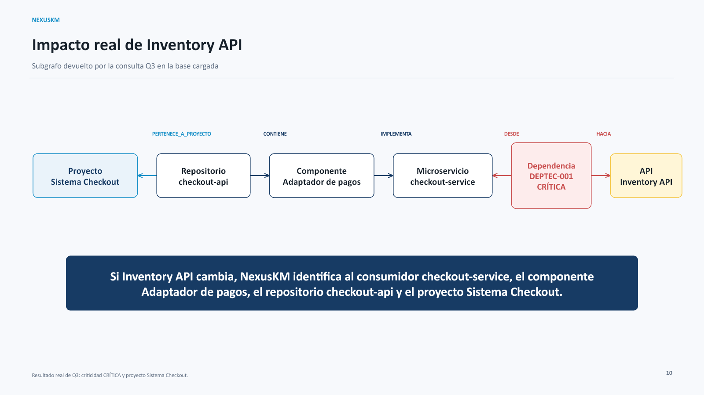

<div align="center">

# NexusKM

**Gestión de conocimiento técnico y análisis de dependencias de software**


[Contexto](contexto/README.md) · [Modelado y scripts](NexusKM/README.md) · [Revisión adversaria](contexto/revision_adversaria.md) · [Avance](contexto/seguimiento.md)

</div>

---

NexusKM reúne el contexto de proyectos, responsables, documentos versionados y dependencias técnicas de una empresa de software. Permite investigar el impacto de cambiar una API, encontrar el conocimiento relacionado y reconstruir las decisiones de aprobación.

El caso académico utiliza datos ficticios de checkout, inventario, pagos y antifraude. La entrega integrada incorpora los modelos relacional, documental y de grafos con una API e interfaz común.

## El problema que aborda

Los contratos de API, runbooks y decisiones de arquitectura suelen quedar distribuidos entre herramientas. Cuando cambia un servicio, el equipo necesita identificar qué lo consume, a qué proyecto pertenece, quién es responsable y qué documentación requiere revisión.

La consulta central del modelo conecta **Inventory API**, su dependencia, **checkout-service**, el componente **Adaptador de pagos**, el repositorio **checkout-api** y **Sistema Checkout**.



*Visualización reconstruida a partir del resultado de Q3 reportado el 12 de noviembre de 2026. La ejecución actual del servidor está pendiente de comprobar.*

## Estado de la solución

| Componente | Estado | Evidencia o siguiente paso |
| --- | --- | --- |
| Modelo de grafos | Modelo y scripts disponibles | Diez scripts Cypher, siete diagramas y resultados históricos. |
| Base relacional | Diseño inicial propuesto | Definir el catálogo, las solicitudes y las transacciones de aprobación. |
| Base documental | Diseño inicial propuesto | Definir contenido anidado de runbooks, contratos y modelos de amenazas. |
| Backend e interfaz | Desarrollo pendiente | Implementar operaciones y coordinación entre las tres bases. |
| Revisión adversaria | Análisis estático disponible | Trece hallazgos y trece escenarios de validación. |
| Pruebas integradas | Pendientes | Completar validación actual, fallos parciales y ejecución reproducible. |

El reporte histórico declara **63 nodos**, **87 relaciones**, **23 etiquetas**, **33 tipos de relación** y **24 restricciones**. Los resultados se conservan en la carpeta de evidencias.

## Arquitectura propuesta

```mermaid
flowchart TB
    UI["Interfaz de usuario"] --> API["API y servicios de aplicación"]
    API --> SQL["Relacional<br/>Catálogo y aprobaciones"]
    API --> DOC["Documental<br/>Contenido versionado"]
    API --> GRAPH["Neo4j<br/>Dependencias e impacto"]

    classDef application fill:#f5f3ff,stroke:#7c3aed,color:#3b0764
    classDef relational fill:#eff6ff,stroke:#2563eb,color:#1e3a8a
    classDef document fill:#ecfdf5,stroke:#059669,color:#064e3b
    classDef graph fill:#ecfeff,stroke:#0891b2,color:#164e63

    class UI,API application
    class SQL relational
    class DOC document
    class GRAPH graph
```

La matriz de propiedad de datos, los identificadores compartidos y el tratamiento inicial de fallos parciales se describen en la [propuesta de arquitectura](contexto/arquitectura_propuesta.md).

## Recursos del proyecto

| Recurso | Contenido |
| --- | --- |
| [Propuesta de aplicación](contexto/tema.md) | Problema, usuarios, operaciones y alcance inicial. |
| [Requisitos académicos](contexto/requisitos.md) | Ocho entregables del proyecto y actividad de modelado de grafos. |
| [Scripts Cypher](NexusKM/cypher) | Esquema, carga ficticia, relaciones, consultas y pruebas. |
| [Diagramas Mermaid](NexusKM/diagramas/README.md) | Modelo lógico, aprobación, excepciones, seguridad y trazabilidad. |
| [Documento académico](NexusKM/documentacion/NexusKM_documento_academico_actualizado.pdf) | Análisis, diccionario, relaciones, reglas y evidencia histórica. |
| [Documento editable](NexusKM/documentacion/NexusKM_documento_academico_actualizado.docx) | Versión de trabajo en Word. |
| [Presentación de clase](NexusKM/presentacion/NexusKM_presentacion_clase_final_actualizada.pptx) | Diecinueve diapositivas sobre el dominio, modelo y ejecución previa. |
| [Evidencias](NexusKM/evidencias/README.md) | Resumen de ejecución, resultados y reconstrucciones del grafo. |
| [Revisión adversaria](contexto/revision_adversaria.md) | Contradicciones, riesgos y casos por probar. |
| [Seguimiento](contexto/seguimiento.md) | Avance por entregable, fechas y decisiones pendientes. |

## Ejecución del grafo

Los scripts usan el conjunto ficticio de NexusKM. La [guía de ejecución](NexusKM/README.md) describe el entorno y las limitaciones técnicas.

1. Comprobar la instancia y la base seleccionada con `00_preflight.cypher`.
2. Aplicar el esquema y cargar los datos siguiendo el orden de `01` a `07`.
3. Ejecutar las consultas de `08_queries.cypher`.
4. Revisar las comprobaciones de `09_tests.cypher` y registrar resultados y fecha.

La revisión adversaria identifica correcciones pendientes en la aprobación del propietario, el filtro de vigencia de Q2 y la validación de propiedades y cardinalidades. Consulta sus hallazgos antes de preparar una nueva demostración.

## Trazabilidad y referencias

El 18 de noviembre de 2026 se incorporaron los **33 archivos** del trabajo previo y su ZIP. La carpeta de origen, el archivo comprimido y las copias migradas se contrastaron mediante SHA-256. El [inventario de migración](contexto/migracion.json) conserva tamaños y hashes. El [ZIP original](contexto/fuentes/antecedentes/NexusKM_paquete_final_ejecutado.zip) permite recuperar ese punto de partida.

- [Guía del proyecto final](contexto/fuentes/Guia_Proyecto_Final_Bases_Datos.pdf).
- [Material de clase sobre modelado de grafos](contexto/fuentes/Modelado%20de%20grafos%20para%20BD.pptx).
- [Anuncio de la actividad](contexto/fuentes/anuncio-classroom.png).
- [Fuentes técnicas del trabajo previo](NexusKM/FUENTES.md).

**Universidad Politécnica de Chiapas** · Ingeniería de datos · Entrega anunciada para el **27 de noviembre de 2026**.
