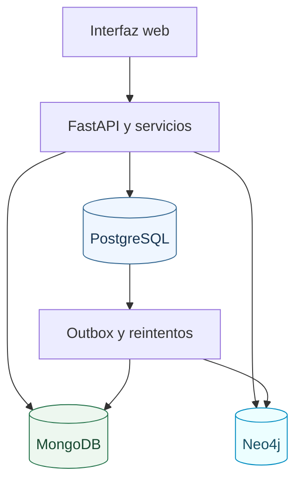

<div align="center">

# NexusKM

**Conocimiento técnico conectado con sus responsables y dependencias**


[Inicio rápido](#inicio-rápido) · [Ocho entregables](docs/README.md) · [Informe y presentación](entrega/) · [Modelos](docs/02-modelado.md) · [Pruebas](docs/08-pruebas-y-manual.md)

</div>

NexusKM es una aplicación de gestión del conocimiento técnico. Conecta APIs, servicios, componentes, proyectos, documentos versionados y responsables. Permite investigar el impacto de un cambio y publicar documentación después de su revisión técnica y de seguridad.

**Nexus** significa vínculo o conexión y **KM** corresponde a *Knowledge Management*, gestión del conocimiento. El caso académico utiliza datos ficticios de Checkout, inventario, pagos y antifraude.


*Captura del servicio local ejecutado el 21 de noviembre de 2026. Inventory API conduce a checkout-service y CHECKOUT; la respuesta combina Neo4j, PostgreSQL y MongoDB.*

## Inicio rápido

Requiere Docker Desktop con motor Linux y Compose v2. No requiere Python en el host para ejecutar la aplicación.

```powershell
git clone https://github.com/LuisNafate/NexusKM.git
Set-Location NexusKM
powershell -ExecutionPolicy Bypass -File scripts/start.ps1
```

Abre **[localhost:58000](http://localhost:58000)**. Inicia sesión con **PER-002** y la contraseña **DEMO_PASSWORD de tu archivo `.env` local**, generado al primer arranque. No compartas ese archivo. [Manual y configuración](docs/08-pruebas-y-manual.md) · [Swagger](http://localhost:58000/docs).

```powershell
powershell -ExecutionPolicy Bypass -File scripts/test.ps1
powershell -ExecutionPolicy Bypass -File scripts/stop.ps1
```

El apagado conserva los datos. El script de pruebas pausa la app y la reinicia al terminar; crea y limpia sus propios registros. No lo ejecutes mientras editas documentos. La reconstrucción con volúmenes nuevos y el reinicio sin resembrar están [verificados](docs/pruebas/evidencias/reconstruccion.json).

## Qué organiza y qué permite hacer

| Área | Capacidad funcional |
| --- | --- |
| Impacto | API → dependencia → servicio → componente → repositorio → proyecto, con documentos vigentes autorizados |
| Documentos | Crear, consultar, renombrar, versionar, editar borrador y dar de baja con historial |
| Aprobaciones | Dos técnicos distintos, propietario real y seguridad para contenido restringido |
| Publicación | Verificar contenido sincronizado, retirar versión anterior y publicar en transacción |
| Auditoría | Actor, fecha y entidad por comando; alcance según rol |
| Consistencia | Outbox durable, revisiones, idempotencia y recuperación sin duplicados |

## Tres modelos con responsabilidades claras



PostgreSQL gobierna catálogos, versiones y aprobaciones; MongoDB conserva contenido anidado por versión; Neo4j conserva dependencias técnicas y proyecciones documentales. El servicio reutiliza IDs y coordina cambios con consistencia eventual explícita. [Comparación tecnológica y fuentes de verdad](docs/03-arquitectura.md).

## Entrega académica

| Entregable | Estado verificable | Recurso |
| --- | --- | --- |
| 1 Propuesta | Problema, usuarios, alcance y 12 RFI | [Propuesta](docs/01-propuesta.md) |
| 2 Modelado | Conceptual, SQL, documental, 23 etiquetas y 33 relaciones | [Modelos y diccionarios](docs/02-modelado.md) |
| 3 Arquitectura | Stack, comparación, autoridad por dato y recuperación | [Arquitectura](docs/03-arquitectura.md) |
| 4 Bases | Tres motores, scripts y carga reproducible | [Implementación](docs/04-implementacion.md) |
| 5 Consultas | 5 SQL, 4 documentales, 9 Cypher y operaciones integradas | [Catálogo](docs/05-operaciones.md) |
| 6 Backend | API, servicios, drivers, autorización y OpenAPI | [API](docs/06-api.md) |
| 7 Aplicación | Interfaz funcional y capturas reales desktop/tablet/móvil | [Aplicación](docs/07-aplicacion.md) |
| 8 Verificación | 39 pruebas aprobadas, reconstrucción y manual | [Pruebas y ejecución](docs/08-pruebas-y-manual.md) |

**[Informe PDF](entrega/NexusKM_informe_integrado.pdf)** · **[Informe editable](entrega/NexusKM_informe_integrado.docx)** · **[Presentación](entrega/NexusKM_presentacion_integrada.pptx)** · **[Guion de demostración](docs/demo.md)** · **[Paquete completo](entrega/NexusKM_entrega.zip)**

## Evidencia y límites

La [verificación actual](docs/pruebas/evidencias/verificacion-integrada.json) registra versiones, consultas completas, integridad y tiempos. [JUnit](docs/pruebas/evidencias/pytest.xml): 39 pruebas sin fallos ni omisiones. La carga nueva tiene 63 nodos y 87 relaciones; tras el ensayo UI conserva 65 nodos y 90 relaciones, incluidos un borrador dado de baja y la publicación de SOL-001. [Resultados y método de medición](docs/pruebas/resultados.md).

La aplicación es una demostración académica local. Los conectores Confluence/GitHub, excepciones con calendario laboral, delegación y escalamiento del grafo previo son extensiones modeladas, sin automatización productiva. SSO, alta disponibilidad, administración completa de usuarios y despliegue público del servicio quedan fuera del alcance. Los catálogos técnicos se mantienen mediante scripts.

## Organización

```text
backend/       API, dominio, autorización y repositorios
frontend/      interfaz web y licencia de tipografía
database/      esquemas, contenido y consultas
NexusKM/       scripts del grafo y antecedentes conservados
scripts/       arranque, carga, pruebas y evidencia
tests/         pruebas contra los tres motores reales
docs/          ocho entregables, modelos, manual y capturas
entrega/       informe, presentación y paquete compartible
contexto/      requisitos, decisiones, revisión y procedencia
```

## Referencias y trazabilidad

[Guía oficial](contexto/fuentes/Guia_Proyecto_Final_Bases_Datos.pdf) · [Modelado de grafos](contexto/fuentes/Modelado%20de%20grafos%20para%20BD.pptx) · [Referencias técnicas](docs/referencias.md) · [Revisión adversaria](contexto/revision_adversaria.md) · [Seguimiento](contexto/seguimiento.md).

El inventario [migracion.json](contexto/migracion.json) registra los 33 archivos de origen y sus hashes; el [ZIP original](contexto/fuentes/antecedentes/NexusKM_paquete_final_ejecutado.zip) permite recuperar esa versión. Las correcciones posteriores están en Git. Los documentos y capturas de `NexusKM/` son antecedentes del 12 de noviembre; la entrega integrada vigente está en `docs/` y `entrega/`.

**Universidad Politécnica de Chiapas · Ingeniería de datos · Profesor Horacio Irán Solís Cisneros · Entrega anunciada 27 de noviembre de 2026.**
