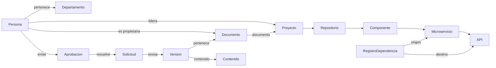
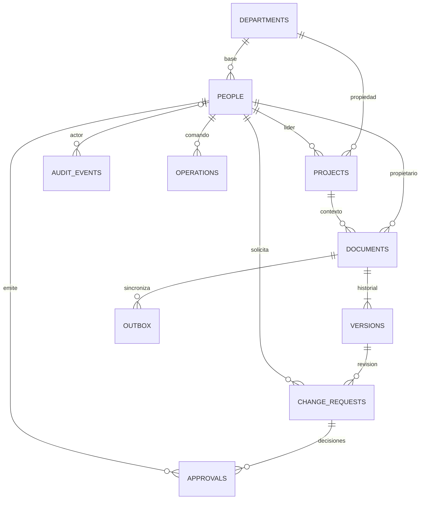

# 2 Modelado de datos

El modelo conceptual relaciona personas y proyectos con documentos versionados y activos técnicos. PostgreSQL conserva las decisiones del flujo; MongoDB guarda el contenido del agregado versión; Neo4j responde preguntas sobre dependencias. Un identificador del dominio se reutiliza en los tres motores.

## Modelo conceptual común



Contenido es un agregado almacenado en MongoDB, no una etiqueta adicional en el grafo. La dependencia permite alternativamente un Documento como origen. El caso central `API-002` es Inventory API, consumida por checkout-service dentro de CHECKOUT.

## Modelo relacional



Una FK exige la existencia del padre; no obliga a que un padre tenga hijos. El mínimo de una versión por documento se conserva al crearlos juntos mediante el servicio. `bootstrap_state` es una tabla técnica de inicialización, no una entidad del negocio.

El [diccionario relacional completo](modelos/diccionario-relacional.md) enumera tipos, obligatoriedad, valores predeterminados, PK, FK y claves alternativas. El [DDL](../database/relational/schema.sql) es la especificación ejecutable. Las tablas separan organización, metadatos, versiones y aprobaciones para evitar grupos repetidos y dependencias de atributos ajenos a su clave. `operations.response`, `audit_events.details` y `outbox.payload` son datos técnicos JSONB con una función delimitada.

Las claves alternas son correo de persona, nombre de departamento, código de proyecto, `(document_id, number)` y `(request_id, reviewer_id, kind)`. Dos índices únicos parciales limitan a una versión vigente por documento y una solicitud abierta por versión. No se realiza borrado físico desde la aplicación.

## Modelo documental

Base `nexuskm`, colección `versions`. Cada documento contiene el contenido completo de una versión. `_id` coincide con `versions.version_id` en SQL y `VersionDocumento.versionId` en Neo4j. No se embeben aprobaciones o personas porque cambian de forma independiente y su autoridad reside en SQL.

```json
{
  "_id": "VER-001",
  "documentId": "DOC-001",
  "kind": "RUNBOOK",
  "revision": 1,
  "content": {
    "summary": "Procedimiento para recuperar la operación de pagos.",
    "sections": [{"heading": "Alcance", "body": "Aplica al servicio de Checkout."}],
    "steps": [{"title": "Verificar", "instruction": "Consultar la reserva de inventario."}]
  }
}
```

| Campo | Tipo y obligación | Unicidad y regla |
| --- | --- | --- |
| _id | string obligatorio | Único por colección; ID de versión común |
| documentId | string obligatorio | Referencia SQL; comprobada por el servicio, sin FK entre motores |
| kind | enum obligatorio | RUNBOOK, API o SEGURIDAD; coincide con metadatos SQL |
| revision | entero obligatorio mayor o igual a 1 | Debe coincidir con content_revision para considerarse listo |
| content.summary | string obligatorio, 10–2000 caracteres | Resumen |
| content.sections | arreglo obligatorio, 1–30 objetos | Cada objeto tiene heading y body de texto |
| content.steps | arreglo no vacío para RUNBOOK | Objetos con title e instruction no vacíos |
| content.endpoints | arreglo no vacío para API | Objetos con path y method no vacíos |
| content.threats | arreglo no vacío para SEGURIDAD | Objetos con title y mitigation no vacíos |

`$jsonSchema` con `validationLevel: strict` valida tipos y estructura en el motor; Pydantic y el servicio aplican límites adicionales. El validador de Mongo permite otros campos, mientras la API rechaza campos superiores desconocidos. El índice `_id` es único; `(documentId, revision)` es de búsqueda, no único porque distintas versiones pueden tener la misma revisión. El reemplazo por `_id` hace idempotente la sincronización. [Validador](../database/document/validator.json) y [carga](../database/document/seed.json).

## Modelo de grafos

El esquema contiene 23 etiquetas y 33 tipos de relación. El [diccionario](modelos/diccionario-grafo.md) documenta todas las propiedades, con al menos tres por entidad; el [catálogo de relaciones](modelos/relaciones-grafo.md) precisa dirección, semántica y mínimos y máximos en ambos extremos. El [diagrama lógico](../NexusKM/diagramas/07_modelo_logico.mmd) resume el núcleo y el catálogo completa las extensiones.

Los nodos principales son Persona, Departamento, Proyecto, Documento, VersionDocumento, Repositorio, Componente, Microservicio, API, RegistroDependencia, SolicitudCambio y Aprobacion. RegistroDependencia convierte la conexión técnica en una entidad con identidad, tipo y criticidad. `DESDE` admite exactamente un origen de la unión Microservicio o Documento; `HACIA` termina en una API. `DEPENDE_DE` es una conexión derivada para recorrido rápido y conserva dependenciaId.

## Restricciones de integridad

| ID | Regla | Dónde se hace cumplir |
| --- | --- | --- |
| I01 | Identificadores y correo únicos | PK/UNIQUE SQL; 24 constraints Neo4j; _id Mongo |
| I02 | Persona tiene un departamento existente | FK NOT NULL SQL; T1 sobre proyección |
| I03 | Proyecto tiene un líder y departamento existentes | Dos FK NOT NULL; T2 y T3 |
| I04 | Versión tiene exactamente un documento | FK NOT NULL; T4 |
| I05 | Documento nace con versión y contenido válido | Transacción del servicio y outbox; validación Mongo |
| I06 | Máximo una versión vigente por documento | Índice único parcial SQL; publicación transaccional |
| I07 | Dos técnicos distintos, activos y ajenos al solicitante | Servicio, unicidad de aprobación, T5, T6 y T13 |
| I08 | Aprobación de propietario corresponde al dueño real | Servicio y T12; un administrador no puede suplantarla |
| I09 | Una aprobación tiene un emisor y una solicitud | FK SQL, sincronización transaccional Neo4j y T11 |
| I10 | Documento restringido necesita aprobación de seguridad | Servicio antes de publicar y pruebas negativas |
| I11 | Publicación exige contenido sincronizado y vencimiento futuro | Servicio, revisión Mongo/SQL y consultas de vigencia |
| I12 | Dependencia tiene un origen y un destino | T7; catálogo de tipos permitidos |
| I13 | Edición de contenido solo en BORRADOR | Servicio y bloqueo SQL; 409 en otros estados |
| I14 | Revisión esperada debe coincidir para modificar | Comparación bajo bloqueo y 409 por concurrencia |
| I15 | Baja sin versión vigente ni solicitud abierta | Servicio; conserva historial y marca inactivo |
| I16 | Reintento del mismo comando no duplica efectos | UUID, hash, actor y bloqueo transaccional SQL |
| I17 | Fallo parcial no pierde una intención confirmada | Outbox SQL; orden por documento y reintento idempotente |
| I18 | Excepción representada con horas positivas, tope y fechas coherentes | T8; calendario laboral y escalamiento automático fuera del alcance |

Las constraints de unicidad de Neo4j Community no equivalen a restricciones de existencia o de cardinalidad. La API controla las escrituras del alcance; quien escriba directamente con credenciales de administrador puede saltarse reglas del servicio. Las pruebas de violación se acompañan de conteos positivos para impedir que una base vacía aparente ser válida.

## Conclusión del modelado

Enumerar entidades no basta: la pregunta de impacto exige dirección de dependencias y un camino hasta el proyecto; la publicación exige identidad de los aprobadores y estados temporales; el contenido requiere una unidad de versión. Las cardinalidades impiden ambigüedades y las fuentes de verdad evitan que tres copias independientes decidan la misma regla. Los modelos se complementan con contratos y pruebas explícitas.
