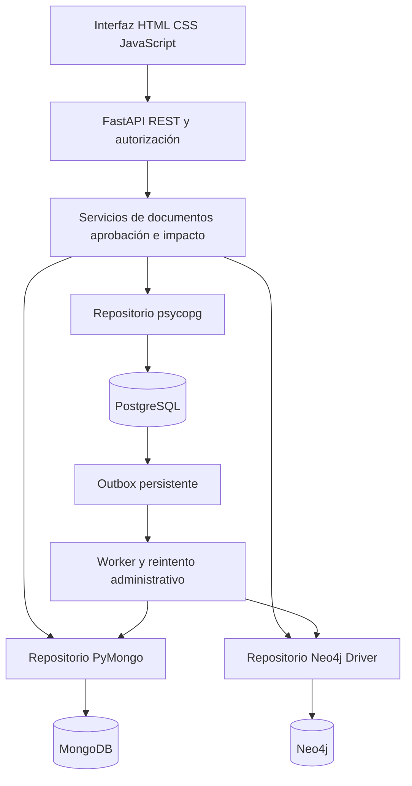
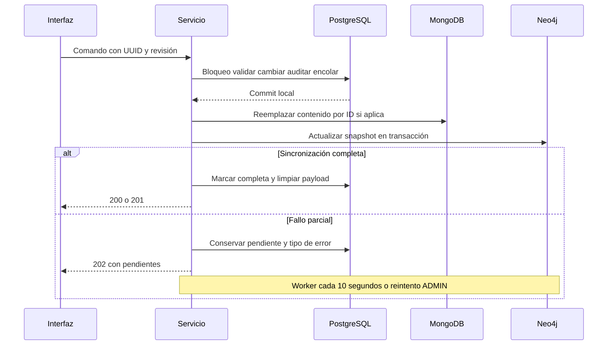

# 3 Arquitectura y decisiones tecnológicas

Se implementó una aplicación web servida por FastAPI con tres repositorios especializados. Docker Compose levanta PostgreSQL, MongoDB, Neo4j y la aplicación en una red interna. La interfaz accede únicamente a la API y el backend usa drivers oficiales.

## Comparación y elección

La evaluación es cualitativa sobre las operaciones del proyecto; no constituye un benchmark de motores.

| Responsabilidad | Alternativas | Elección y motivo | Coste asumido |
| --- | --- | --- | --- |
| Gobierno transaccional | PostgreSQL, MySQL, SQLite | PostgreSQL 16 por FK, transacciones, índices parciales y SKIP LOCKED para outbox | Servicio separado y administración |
| Contenido por versión | MongoDB, PostgreSQL JSONB, archivos JSON | MongoDB 7 por agregado documental, validación y requisito de modelo independiente | Referencias entre motores se comprueban en aplicación |
| Dependencias | Neo4j, tablas de aristas en SQL, referencias Mongo | Neo4j 5.26 Community por Cypher y recorridos expresivos; reutiliza el grafo previo | Cardinalidades y obligatoriedad requieren servicio y pruebas |
| Backend | FastAPI, Django REST, Express | FastAPI por tipos, validación, OpenAPI y pruebas con TestClient | Drivers síncronos ejecutados en endpoints de trabajo síncrono |
| Contrato | REST, GraphQL | REST por operaciones conocidas y contrato sencillo | Varias rutas para acciones explícitas |
| Interfaz | HTML/JS, React | HTML/CSS/JS sin compilador, suficiente para cuatro vistas y diálogos | Estado y renderizado gestionados explícitamente |
| Ejecución | Instalación nativa, Compose, proveedor cloud | Compose con imágenes fijadas por digest y dependencias bloqueadas | Requiere Docker Desktop y recursos locales |

La API no promete transacciones ACID que abarquen los tres motores. Se eligió consistencia eventual explícita para proyecciones, con una transacción ACID local en PostgreSQL y recuperación durable.

## Fuente de verdad y copias

| Dato | Autoridad de escritura | Copia o referencia | Regla de actualización |
| --- | --- | --- | --- |
| Personas, roles operativos y proyectos | PostgreSQL | Nodos de catálogo en Neo4j cargados al inicio | Catálogos de demostración no editables por API |
| Documento, propietario, proyecto y estado activo | PostgreSQL | Documento y relaciones en Neo4j | Snapshot desde SQL por outbox |
| Número, estado y vencimiento de versión | PostgreSQL | VersionDocumento en Neo4j | Snapshot por documento |
| Contenido y revisión del agregado | MongoDB | SQL mantiene content_revision y payload transitorio | Intención se confirma en outbox SQL; payload se borra al completar |
| Solicitud y aprobación | PostgreSQL | SolicitudCambio y Aprobacion en Neo4j | Sustitución idempotente por ID en una transacción del grafo |
| Dependencias y activos técnicos | Neo4j | IDs de proyecto permiten unir resultados SQL | Carga Cypher en base nueva |
| Auditoría actual y operaciones idempotentes | PostgreSQL | Historial legado del grafo se conserva separado | Solo inserción mediante servicio actual |

Los eventos históricos de Sincronizacion con Confluence/GitHub no representan el worker actual. La recuperación vigente reside en `outbox`; su panel no consulta esos nodos ficticios.

## Protocolo de escritura y recuperación

El worker selecciona eventos con `FOR UPDATE SKIP LOCKED`, excluye eventos con un predecesor pendiente del mismo documento y bloquea su fila. Una escritura nueva de ese documento se rechaza con 409 mientras haya pendientes. Si Mongo termina y Neo4j falla, el evento permanece; repetir el upsert no crea otra versión. Se construye el grafo desde el snapshot SQL actual, sin confiar en metadatos del cliente.

La clave de idempotencia se conserva en `operations`. Repetir actor, acción y cuerpo devuelve los mismos IDs con `replayed: true`; reutilizar el UUID con otra intención da 409. Los bloqueos y revisiones evitan pérdida de actualizaciones concurrentes. La prueba de fallo parcial inyecta una excepción del repositorio Neo4j para observar recuperación sobre las bases reales; no equivale a ensayar una caída de red completa.

La consulta integrada obtiene caminos técnicos de Neo4j, recupera proyectos y versiones vigentes de PostgreSQL y adjunta contenido autorizado de MongoDB. Informa las fuentes usadas y pendientes. Un fallo de consulta de un motor produce 503; la aplicación no fabrica un resultado completo con datos ausentes.

## Seguridad y operación

Los puertos del host se enlazan a 127.0.0.1. `.env` guarda contraseñas y secretos fuera de Git; `.env.example` define el contrato con valores de reemplazo. Las contraseñas de demostración se almacenan mediante PBKDF2 con sal y el token firmado caduca en una hora. Las consultas SQL y Cypher usan parámetros; los nombres de tablas de las utilidades se construyen con identificadores seguros.

La versión académica local carece de TLS, límites de intentos de login, revocación centralizada de sesiones y separación de usuarios DB con privilegios mínimos. Antes de un despliegue público deben resolverse esas necesidades y definir retención, respaldo y recuperación. No se publica `.env` en el paquete ni en el repositorio.
