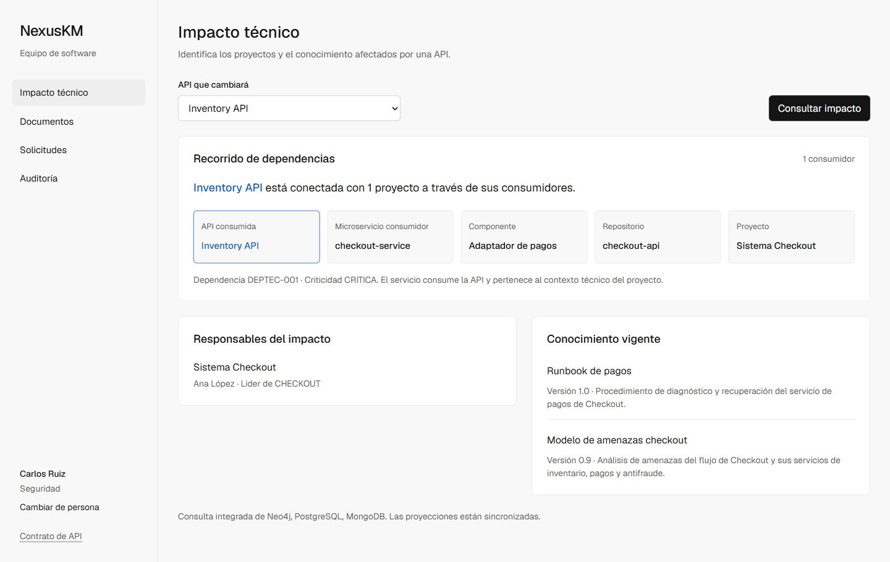
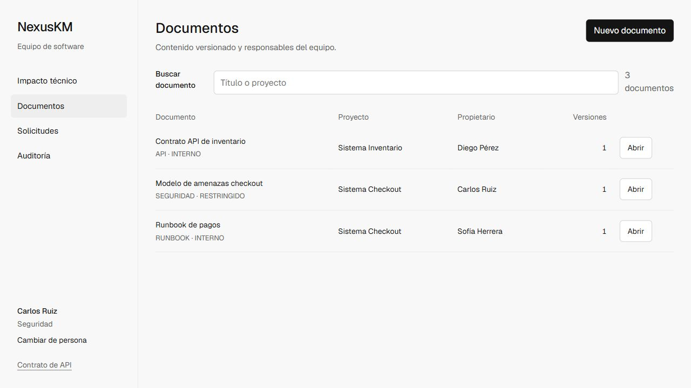
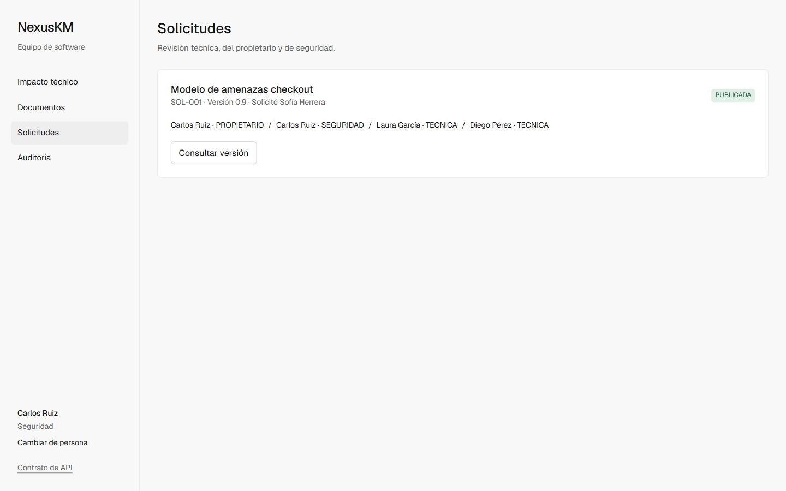
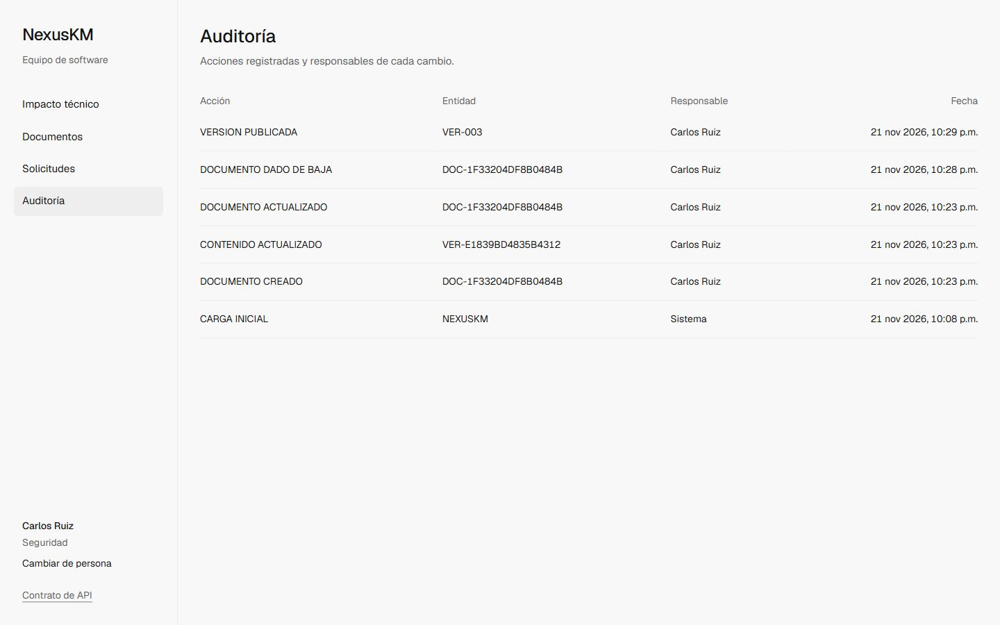

# 7 Aplicación e integración

La interfaz funcional ofrece Impacto, Documentos, Aprobaciones y Auditoría. Administración dispone del control de pendientes y reintento. La API sirve los archivos estáticos y valida permisos en el servidor. La aplicación se abre en `http://localhost:58000` después de arrancar Compose.

## Consulta de impacto

La selección Inventory API consulta Neo4j y encuentra checkout-service, su componente y CHECKOUT. PostgreSQL aporta responsables y versiones vigentes; MongoDB entrega secciones y contenido. La pantalla informa las fuentes usadas. Después de publicar SOL-001, Carlos puede ver el runbook y el modelo de amenazas de Checkout; un usuario sin permiso recibe solo los documentos autorizados.

## Gestión documental

El propietario crea un documento con contenido acorde al tipo, abre su detalle, edita un borrador, modifica el título o crea una nueva versión. La baja exige confirmación en un diálogo de la propia aplicación y está limitada por las reglas de publicación y revisión. La revisión esperada viaja con la operación para detectar cambios concurrentes.

El ensayo en navegador creó `Runbook de verificación de interfaz`, editó su contenido, lo renombró y dio de baja. La captura [baja verificada](pruebas/evidencias/04-baja-verificada.jpg) muestra el catálogo activo de nuevo con tres documentos. El registro permanece en SQL/Mongo/Neo4j por la política de historial; no es un residuo de prueba fallida.

## Revisión y publicación

Una solicitud nueva pasa a revisión, registra dos aprobaciones técnicas distintas, la del propietario y seguridad si aplica. Al cumplirlas, queda APROBADA; el propietario publica y la versión pasa a VIGENTE. La solicitud de ejemplo SOL-001 se publicó realmente desde el navegador; la imagen confirma PUBLICADA. El estado APROBADA del seed ya no describe esa instancia después de la demostración.

## Auditoría y adaptación

La auditoría actual incluye alta, edición de contenido, cambio de título, baja y publicación con actor y fecha. Se verificaron anchos 1440, 768 y 390 píxeles; la navegación móvil abre sus secciones y las tablas conservan desplazamiento propio. [Vista móvil](pruebas/evidencias/09-movil.jpg).

Las capturas son del servicio ejecutado y no reconstrucciones. La [bitácora de interfaz](pruebas/evidencias/ui-verificacion.json) registra flujos y correcciones: confirmación propia para evitar bloqueo del navegador y protección frente a respuestas asíncronas que intentaban pintar una vista abandonada.

## Flujo completo entre motores

1. Un propietario crea metadatos y contenido; SQL confirma el comando y el evento de sincronización.
2. Mongo recibe el agregado por ID de versión y Neo4j la proyección por ID documental.
3. La interfaz consulta el detalle y refleja el contenido y la revisión.
4. La solicitud y aprobaciones cambian el estado oficial en SQL; Neo4j recibe el snapshot.
5. La publicación verifica contenido Mongo y reglas SQL; la consulta de impacto atraviesa el grafo y devuelve esa versión autorizada.
6. Si falla la proyección, la respuesta indica pendiente; ADMIN o el worker repite la entrega y converge sin duplicados.

La [matriz de pruebas](pruebas/matriz.md) enlaza los casos automatizados. El [guion](demo.md) permite repetir una demostración sin depender de los cambios ya realizados en la instancia actual.
